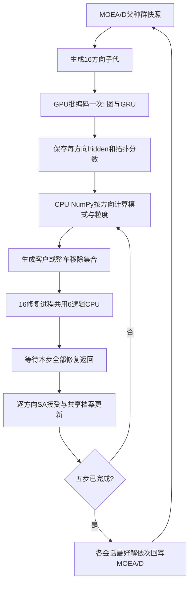

# 网络与执行契约

## 原专家与共享 Controller

`source/repo/network.py::load_base` 根据方向编号加载上一冻结版的对应专家。16份 `physical_bilinear` 与16份 `route_bilinear` 在 CORE_CHECK 中均为16个不同矩阵，encoder张量在16专家之间相同。V9训练只更新共享Controller和Critic；原专家的encoder、GRU、context、FiLM、模式/Beta头、客户与路线打分参数均冻结。

原专家是128维GAT/GRU编码、context与状态条件化的结构化破坏策略。专家头产生三模式logits、各模式Beta参数及客户/路线分数。V9在这些基础输出上叠加一个共享控制器。Controller是 `Linear(22,32)→Tanh→Linear(32,4)`；隐藏权重orthogonal、隐藏偏置0、输出权重正态std=.01、输出偏置0。Controller自身没有新增FiLM模块；原专家既有q_film保持。

设输出为y。模式分布为 `Categorical(base_mode_logits+y[:3])`。每个模式的原参数为a,b，c=a+b，p=a/c；新中心为 `sigmoid(logit(p)+y[3])`，再限制到 `[(1+1e-6)/c,1-(1+1e-6)/c]`，新参数为pc与(1-p)c。NumPy实现另将sigmoid输入截到[-80,80]。浓度c保持；第四个输出对三个模式共用。没有按规模划分的模式偏置或±.15偏移上限。

## Controller的22个输入

顺序与 `v9_policy.py::CONTEXT_FIELDS` 相同。

|序号|字段|实际数值|
|---:|---|---|
|0|log_n50|log(N/50)|
|1|n250|N/250|
|2–6|lambda0..4|当前方向五维偏好|
|7|step_fraction|min(1,5×(1−remaining_attempt_fraction)/4)，正常五步为0、.25、.5、.75、1|
|8|stagnation|min(跨会话方向停滞数,30)/30|
|9|temperature_fraction|当前温度/会话初温|
|10|mean_load_fraction|全部客户需求/(路线数×车辆容量)|
|11|route_count_fraction|路线数/N|
|12|time_remaining|整场剩余墙钟比例|
|13|mean_route_length|客户所属路线客户数/N，在全部客户上取均值|
|14|mean_detour|删除客户的距离增量/实例最大距离，在客户上取均值|
|15|mean_makespan_slack|(最大路线完成时间−所属路线完成时间)/仓库时域，在客户上取均值|
|16|mean_waiting|客户等待/仓库时域的均值|
|17|mean_tardiness|客户延误/仓库时域的均值|
|18|archive_gap|tanh(当前标量值−档案最小标量值)|
|19|archive_nearest|tanh(动态归一化目标空间中距最近不同档案点的距离)，无不同点时0|
|20|archive_other|是否存在目标不同的档案点|
|21|last_repair_sec|当前方向上一次修复实际结束−开始的墙钟秒数；run起点0|

三个档案摘要在每步调用时根据当前共享档案计算。它们是这三个确定统计量，不是档案点集编码器。跨会话停滞计数按方向保存，完整五步后若刷新历史记录解则清零，否则加一；历史记录解在当前动态坐标下重新评分。GRU状态不跨不同子代会话串接。

## 破坏模式与粒度

所有规模、所有模式共用：

```
cap = min(round(.45*N),100)
lo = max(3,round(.04*N))
hi = min(N,int(cap),max(12,min(round(.35*N),60)))
lo = min(lo,hi)
q_target = round(lo + u*(hi-lo))
```

Python/NumPy使用round/rint的半数取偶语义。N=50/150/250的目标范围分别是[3,18]、[6,52]、[10,60]；这些值来自同一公式，未定义分规模区间表。u从选定模式的Beta分布随机采样。

- Mode0：按客户分数采样锚点，在其近邻候选中按PL有序前缀抽取其余客户。
- Mode1：对全体客户分数按PL有序前缀抽取客户。
- Mode2：按路线分数采样整车顺序，依序移除完整路线，累计客户数达到min(q_target,cap)后停止。最后一条路线完整保留于移除集合，因此实际q可能超过目标或cap；不做末车部分客户截取。`first_route_exceeds_cap`字段只检查首条路线是否超cap。密度记录实际选中路线前缀的PL对数概率。

客户分数继续用缓存的values_lo/values_hi按当前q/N插值，再加标准化物理特征与原专家physical_weights的乘积。路线分数继续用原route_bilinear和route_score_scale。没有额外的手工偏好客户加分项。Mode2的原路线数粒度已改为客户数目标；它与旧版动作定义不同。

## GPU、NumPy、缓存与同步

每个16方向批次从同一父种群快照生成子代。会话首步将活跃方向图组成GPU batch，共享相同encoder的一次批编码；方向头使用各自权重。每个方向会话入口GRU hidden为0。其后四步复用该次hidden及拓扑缓存，不再次运行GRU/encoder；接受新解后重算物理特征和路线统计。因而本版五步内没有逐步GRU递推。

模式、Beta、Controller、客户和路线采样在主进程依方向顺序以CPU NumPy执行。每步收集各方向修复任务，交给16个持久进程，等本步全部返回后分别接受/拒绝，再生成下一步。16进程分别绑定逻辑CPU8–13，主进程逻辑CPU6–7；不是16独占物理核。已完成方向不会提前进入下一步。外层交叉、接受结果处理及批末种群回写在主进程执行。

## 接受、档案和返回外层

每方向维护当前解与会话最好解。可行候选若更好或等分，以概率1接受；较差候选以exp(−Δg/T)接受。五步温度为 `T0×.01^(j/4)`，j=0..4，T0=−.01/log(.5)，末温为T0×.01。温度标定不是学习输出。

修复与标量比较使用原动态五目标评分，`max(lambda*z)+.05*sum(lambda*z)+.001*sum(z)+reference_excess`。可行且在总截止前完成检查的发现参与档案；SA当前解接受与档案入档分开处理。完整五步后把会话最好解交给原MOEA/D `_replace`，替换仍包括self、支配优先、快照判重和gainTop2。在线时间耗尽时不再开启新候选，完整训练会话判定会排除迟到/不足五步的方向样本。

## 执行顺序图



任一环节受整场截止限制。上图五步回边复用缓存，不回到GPU编码节点。
